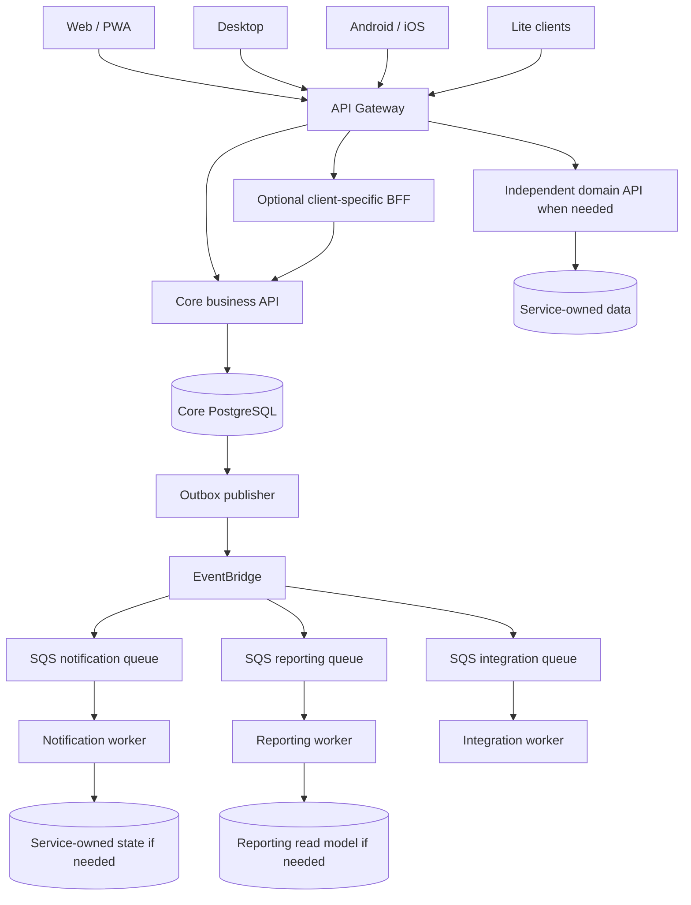

# FDE Kit — Enterprise Serverless Technology Standard

> Status: Recommended baseline | Scope: New business software projects | Architecture: API-first, modular core, event-driven, multi-client

## 1. Purpose and operating instructions

Use this document as the default engineering policy when planning, scaffolding, implementing, reviewing, or deploying a new business application. Build one business platform with independently deployable clients and backend services. Prefer maintainability, security, correctness, and low operational cost over architectural complexity.

Treat this as a baseline, not a mandate to provision every component. Inspect the existing repository, requirements, constraints, cloud account, and conventions before making changes. Preserve existing working architecture unless migration is explicitly authorized. Record deviations and reasons in architecture decision records (ADRs). Never claim a deployment, test, or migration succeeded without evidence.

## 2. Standard technology stack

| Layer | Default | Conditional alternative |
|---|---|---|
| Primary language | TypeScript, strict mode | Python for AI/data; Go for measured performance needs |
| Web | React + Vite | SSR framework when SEO or server rendering is required |
| Desktop | Tauri + React | Electron when native integrations require it |
| Android / iOS | React Native + Expo | Kotlin / Swift for necessary native functionality |
| Lite clients | PWA or reduced-feature Expo build | Kotlin + Jetpack Compose / SwiftUI when justified |
| Core API | NestJS on Node.js | Laravel for existing PHP projects |
| Lightweight services | Hono | NestJS for complex service domains |
| AI/data services | Python + FastAPI | Batch or queue workers without HTTP where appropriate |
| API | REST + OpenAPI | WebSockets for real-time requirements |
| Validation | Zod or NestJS DTO validation | One consistent runtime strategy per service |
| Relational data | PostgreSQL + Drizzle ORM | Prisma if project convention favors it |
| NoSQL | DynamoDB | Only for access patterns that justify it |
| Identity | OAuth 2.0 / OpenID Connect | Cognito or existing enterprise identity provider (e.g. Entra ID) |
| Repository | Nx + pnpm workspaces | Existing workspace tooling when appropriate |
| Unit/integration tests | Vitest or Jest | pytest for Python |
| End-to-end tests | Playwright (web/API) | Maestro or native tooling for mobile |
| Infrastructure | AWS CDK in TypeScript | Existing approved infrastructure-as-code standard |
| CI/CD | GitHub Actions | Existing approved pipeline |
| Observability | OpenTelemetry + CloudWatch | Existing approved telemetry platform |

Use supported stable versions compatible with one another. Pin runtime and dependency versions, commit lockfiles, and verify official documentation before introducing new integrations. Do not invent version numbers.

## 3. Reference architecture



The core is a modular monolith at the start, not a universal proxy. Keep business domains isolated internally; extract independently deployable services only when justified by ownership, scale, isolation, security, or release cadence. Gateway routes may reach services directly. BFFs are optional adapters, not owners of business rules.

## 4. Repository blueprint

```text
business-platform/
  apps/
    web/
    desktop/
    mobile/
    mobile-lite/           # optional
    admin-portal/          # optional
  backend/
    core-api/
      src/modules/<domain>/
        domain/
        application/
        infrastructure/
        presentation/
    notification-service/  # only if needed
    reporting-service/
    integration-service/
  packages/
    api-contracts/
    api-client/
    event-contracts/
    validation/
    design-tokens/
    ui-web/
    ui-mobile/
  infrastructure/cdk/
  tests/contract/
  tests/e2e/
  docs/adr/
  .github/workflows/
  nx.json
  pnpm-workspace.yaml
  .env.example
  README.md
```

Scaffold only required applications and services. Every deployable unit must have a clear owner, build target, test target, configuration contract, and deployment target. Shared packages must not expose database entities, secrets, or internal domain implementations to clients. Enforce dependency boundaries with lint rules. Avoid circular dependencies.

## 5. Backend engineering rules

- Domain layer: entities, value objects, invariants, and business rules; no cloud SDK or HTTP dependencies.
- Application layer: use cases, ports, transaction boundaries, and orchestration.
- Infrastructure layer: database repositories, cloud integrations, queue adapters, identity adapters.
- Presentation layer: controllers, request validation, response mapping, and authorization enforcement.
- Use dependency injection where useful; avoid unnecessary abstraction for trivial CRUD.
- Each service owns its writes and data model. A shared physical database may be acceptable initially, but enforce schema/ownership boundaries. No cross-service direct writes.
- Keep authoritative business calculations and authorization on the backend. Do not trust the client to enforce business invariants.
- Use synchronous calls when an immediate result is needed; events for asynchronous side effects and decoupling.
- Avoid distributed transactions; use compensating workflows when a multi-service operation requires them.

## 6. API and client contract

- Version public APIs, e.g. `/v1/employees`. Preserve backward compatibility for installed mobile and desktop applications.
- Maintain OpenAPI specifications and generate typed clients for TypeScript, Kotlin, Swift, or other consumers as needed.
- Validate all external input at runtime; TypeScript interfaces alone do not validate JSON.
- Standardize HTTP status codes, RFC 9457 problem details, request IDs, pagination, filtering, and timestamps (UTC ISO 8601).
- Use idempotency keys for retryable write operations where duplicate execution is harmful.
- Never expose persistence entities directly. Return purpose-built response DTOs.
- Enforce tenant and resource-level permissions on every relevant request.
- Use scoped CORS for browsers. Store mobile/desktop credentials using platform-secure storage; use secure browser sessions or an appropriate OAuth flow.
- Use authorization code + PKCE for public native clients. Never embed confidential client secrets in applications.

### Multi-platform strategy

| Client | Design requirement |
|---|---|
| Web | Responsive, accessible, CDN-hosted SPA |
| Desktop | Reuse web UI where practical; isolate native capabilities |
| Mobile | Native navigation, secure storage, push and offline support when required |
| Lite | Smaller assets, fewer requests, reduced features, caching, low-memory operation |

Start with a common API. Add `/v1/lite/...` or a BFF only if payloads, aggregation, or network constraints justify it. Offline writes require explicit conflict resolution and deduplication. Separate store builds only when they provide real user value and comply with distribution requirements.

## 7. Events and reliable background processing

Example: Create purchase request → validate permissions and budget → commit request and outbox record atomically → publish event → queue workers send notifications and update reporting.

Use a transactional outbox for business events that must not be lost. Implement an actual relay (poller or CDC), retries, and monitoring; writing an outbox record alone does not publish an event.

Event envelope example:

```json
{
  "eventId": "unique-event-id",
  "eventType": "procurement.purchase-request.created",
  "schemaVersion": 1,
  "occurredAt": "2026-01-01T00:00:00Z",
  "correlationId": "request-id",
  "tenantId": "tenant-id",
  "data": { "purchaseRequestId": "pr-id" }
}
```

Assume at-least-once delivery and possible reordering. Make consumers idempotent with durable deduplication where needed. Configure bounded retries, backoff, dead-letter queues, queue age alarms, and authorized replay procedures. Keep sensitive personal data out of event payloads unless strictly required. Version event contracts and test compatibility.

## 8. AWS deployment mapping

| Capability | Default AWS service | Provisioning condition |
|---|---|---|
| Static web hosting | S3 + CloudFront | Web client exists; private bucket with origin access control |
| HTTP API | API Gateway | Public or private API required |
| Compute | Lambda | Stateless, short-lived workloads |
| Containers | ECS Fargate | Long-running work, custom runtime or persistent process needed |
| Relational database | Aurora PostgreSQL Serverless v2 or managed PostgreSQL | Relational persistence required; compare cost and capacity |
| Connection management | RDS Proxy | Connection pressure and compatibility justify it |
| Key-value data | DynamoDB | Known access patterns justify it |
| Events | EventBridge | Event routing across domains |
| Queue | SQS | Durable asynchronous work |
| Files | S3 | Object storage; private by default, signed access where appropriate |
| Identity | Cognito or external OIDC | Authentication required |
| Push | FCM / APNs, optionally SNS | Mobile push required |
| Scheduling | EventBridge Scheduler | Scheduled jobs needed |
| Orchestration | Step Functions | Multi-step durable workflows needed |
| Secrets | Secrets Manager / Parameter Store | Runtime configuration and secrets |
| Monitoring | CloudWatch + OpenTelemetry / X-Ray | Production baseline |
| DNS | Route 53 | Managed domain/DNS required |
| IaC | AWS CDK | All cloud environments |

### Serverless constraints

Keep Lambda handlers stateless; reuse safe SDK/database clients across warm invocations. Configure timeouts, memory, concurrency, and retry policies intentionally. Store durable state outside execution environments. Use direct signed S3 uploads for large files and asynchronous workers for slow jobs. Measure NestJS cold starts before optimizing. Use Fargate when Lambda limits or workload economics make it unsuitable.

Serverless is not automatically free or cheaper. Estimate database minimum capacity, networking/NAT, logging, egress, API traffic and compute costs. Set budgets and cost alerts; alerts are not hard spending caps. Prefer the smallest infrastructure that satisfies requirements. Select regions using residency, latency, availability, and cost constraints rather than assuming a region.

## 9. Security and business readiness

- Least-privilege IAM roles per workload and environment; deny public data access by default.
- Separate development, staging, and production environments/accounts where practical.
- Use TLS, encryption at rest, managed secrets, rotation policies, and short-lived CI credentials via OIDC.
- Apply authentication, authorization, tenant isolation, rate limits, input validation, and abuse controls.
- Define audit logs for sensitive business actions with actor, action, target, outcome, and timestamp. Restrict access and prevent sensitive values from leaking into logs.
- Establish retention, deletion, backup, restore testing, and recovery objectives (RPO/RTO) based on business requirements.
- For Philippine personal data projects, assess Data Privacy Act obligations and organizational privacy policies; do not claim compliance without review.
- Scan dependencies and secrets, review security findings, and apply patches.
- Never commit real credentials or production personal data. Use synthetic test fixtures.

## 10. CI/CD and quality gates

For each affected deployable unit:

1. Install locked dependencies; lint and format check.
2. Type-check (strict mode; no blanket `any` or suppressed errors).
3. Run unit, integration, and relevant contract tests.
4. Build artifacts and scan dependencies/secrets.
5. Synthesize infrastructure and review the proposed diff.
6. Deploy to development/staging through approved CI roles.
7. Run smoke, authorization, tenant-isolation, and relevant end-to-end tests.
8. Require explicit approval for production promotion and risky/destructive migrations.
9. Verify health, error rate, latency, queue backlog and deployment outcomes.
10. Document rollback or forward-fix procedures; use backward-compatible expand/contract migrations.

Do not silently skip failed tests or weaken security gates. Report unrun checks, missing credentials, and environment limitations. Do not execute paid cloud provisioning, production changes, destructive operations, or external communications without authorization.

## 11. FDE automation workflow

When given a product requirement, execute this workflow with available tools and permissions:

1. **Discover:** inspect repository, requirements, existing integrations, users, data sensitivity, workload, budget, deployment constraints and acceptance criteria.
2. **Design:** propose domain boundaries, clients, API contracts, persistence, event flow, threat model, and minimal deployment topology. Record assumptions and ADRs.
3. **Plan:** generate a dependency-ordered implementation backlog with acceptance criteria and tests. Separate required components from optional enhancements.
4. **Scaffold:** create only needed workspace projects, shared packages, configuration schemas, local development setup and CI workflows.
5. **Implement:** deliver vertical slices end-to-end (database migration, domain, use case, API, client, tests); do not build every layer in isolation first.
6. **Validate:** run available checks, test failure paths and permissions, inspect deployment diffs, and estimate recurring costs.
7. **Deliver:** produce a concise change summary, file list, commands, test results, assumptions, known risks, and next actions. Deploy only to authorized targets.

If an essential requirement is missing, ask a focused question or explicitly document a reversible assumption. Prefer working increments over speculative infrastructure. Do not rewrite unrelated files, overwrite user work, or fabricate test results.

## 12. Required project deliverables

- `README.md`: setup, run, test, build, deployment and troubleshooting instructions.
- `docs/architecture.md`: system context, component boundaries, data flow and deployment diagram.
- `docs/adr/`: significant architecture decisions and alternatives.
- OpenAPI contract and event schemas where applicable.
- Database schema, migrations, seed data (synthetic only), and recovery plan.
- `.env.example` with placeholders and configuration validation.
- CI/CD workflows, CDK stacks, monitoring and operational runbook.
- Tests covering critical business rules, permissions, failure paths and API compatibility.
- Cost assumptions and security/privacy checklist appropriate to project scope.

## 13. Definition of done

A feature is complete only when its acceptance criteria are met, business logic is validated, permissions are enforced, affected API contracts remain compatible, applicable tests pass, configuration and migrations are documented, observability is adequate, and known limitations are reported. A scaffold is not a production-ready system. Deployment success requires actual verification.

## 14. Adoption stages

- **Stage 1 — Foundation:** React web, NestJS modular core, PostgreSQL, identity, contracts, local development and CI.
- **Stage 2 — Serverless:** deploy the smallest viable AWS topology with monitoring and budgets.
- **Stage 3 — Asynchronous services:** introduce queues, outbox and independent workers as real use cases emerge.
- **Stage 4 — Clients:** add desktop, mobile and Lite builds when validated by user needs.
- **Stage 5 — Scale:** extract domains, optimize data and compute, strengthen resilience and operational controls using measured evidence.

## 15. Official documentation starting points

- TypeScript: https://www.typescriptlang.org/docs/
- NestJS: https://docs.nestjs.com/
- Hono: https://hono.dev/docs/
- Expo: https://docs.expo.dev/
- Tauri: https://v2.tauri.app/
- Nx: https://nx.dev/
- OpenAPI: https://spec.openapis.org/
- AWS Lambda: https://docs.aws.amazon.com/lambda/
- AWS CDK: https://docs.aws.amazon.com/cdk/
- AWS Well-Architected: https://docs.aws.amazon.com/wellarchitected/

**Core principle:** One business platform, many independent client applications, and independently scalable services where they are justified.
